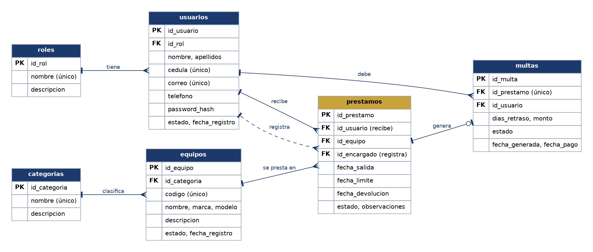
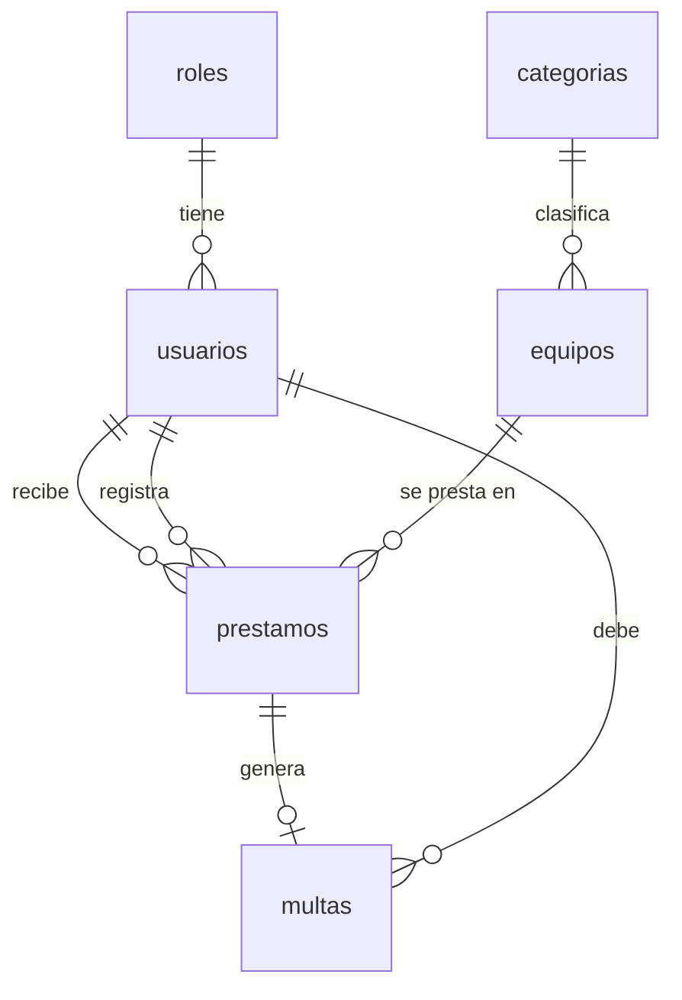

# Sistema web de gestión de préstamos de equipos y recursos

Proyecto final integrador · Programación V · Universidad Autónoma de Centro América
**Entregable 2: avance del código**

Aplicación web cliente-servidor para registrar equipos, prestarlos, recibir devoluciones y controlar multas por retraso en una institución educativa.

**Repositorio:** _pegue aquí el enlace de GitHub_
**Integrantes:** _escriba aquí los nombres del grupo_

## Tecnologías

| Capa | Herramientas |
|---|---|
| Front End | HTML5, CSS3, JavaScript y Bootstrap 5.3 |
| Back End | PHP 8 (PDO, sesiones, `password_hash`) |
| Base de datos | MySQL / MariaDB, motor InnoDB |
| Servidor local | Apache mediante XAMPP |
| Control de versiones | Git y GitHub |

## Instalación en XAMPP

1. Encienda **Apache** y **MySQL** desde el panel de XAMPP.
2. Copie la carpeta del proyecto en `C:\xampp\htdocs\prestamos-equipos` (el nombre de la carpeta debe coincidir con `BASE_URL` en `config/app.php`).
3. Abra `http://localhost/phpmyadmin`, entre a la pestaña **Importar** y cargue `database/prestamos_equipos.sql`. El script crea la base `prestamos_equipos`, las tablas, las vistas y los datos de prueba.
4. Si su MySQL tiene contraseña para `root`, cámbiela en `config/database.php`.
5. Abra `http://localhost/prestamos-equipos/`.

### Usuarios de prueba

| Rol | Correo | Contraseña |
|---|---|---|
| Administrador | admin@prestamos.test | Admin123* |
| Encargado | encargado@prestamos.test | Encargado123* |
| Usuario | maria.jimenez@prestamos.test | Usuario123* |

Los datos de prueba incluyen un préstamo vencido, uno devuelto con retraso (multa pendiente de Sofía Mora) y equipos en todos los estados.

## Estructura del proyecto

```
prestamos-equipos/
├── index.php, login.php, logout.php, dashboard.php
├── config/
│   ├── app.php               Nombre, BASE_URL, multa por día, zona horaria
│   └── database.php          Conexión PDO a MySQL
├── includes/
│   ├── init.php              Arranque común (config, sesión, funciones)
│   ├── auth.php              Sesión y control de acceso por rol
│   ├── functions.php         Escape de HTML, CSRF, mensajes, formatos
│   ├── componentes.php       Piezas de interfaz reutilizables
│   └── header.php, footer.php   Menú lateral y cierre de página
├── modules/
│   ├── usuarios/             index · form (crear/editar) · eliminar
│   ├── categorias/           index · form (crear/editar) · eliminar
│   ├── equipos/              index · form (crear/editar) · eliminar
│   ├── prestamos/            index · nuevo · devolver
│   ├── multas/               index · pagar
│   └── reportes/             index (vencidos, más prestados, por usuario)
├── assets/
│   ├── css/style.css
│   └── js/app.js
├── database/prestamos_equipos.sql
└── docs/diagrama_er.png, diagrama_er.dot
```

Cada módulo sigue el mismo patrón: `index.php` lista y busca, `form.php` crea o edita (valida en el servidor y guarda con consultas preparadas) y `eliminar.php` borra por POST con token CSRF.

## Base de datos

Seis tablas relacionadas con llaves primarias y foráneas, más tres vistas de consulta.





| Tabla | Para qué sirve | Llaves foráneas |
|---|---|---|
| `roles` | Administrador, encargado y usuario | — |
| `usuarios` | Cuentas de acceso y personas que reciben equipos | `id_rol` → roles |
| `categorias` | Agrupa los equipos | — |
| `equipos` | Inventario con estado: disponible, prestado, mantenimiento, baja | `id_categoria` → categorias |
| `prestamos` | Fecha de salida, fecha límite y fecha de devolución de cada préstamo | `id_usuario`, `id_equipo`, `id_encargado` |
| `multas` | Multa automática por retraso, una por préstamo | `id_prestamo`, `id_usuario` |

Vistas: `v_prestamos_detalle` (préstamos con usuario, equipo y estado real: en curso, vencido o devuelto), `v_prestamos_vencidos` y `v_equipos_mas_prestados`.

## Roles y permisos

| Acción | Administrador | Encargado | Usuario |
|---|:-:|:-:|:-:|
| Iniciar y cerrar sesión | Sí | Sí | Sí |
| Ver equipos disponibles | Sí | Sí | Sí |
| Ver sus propios préstamos y multas | Sí | Sí | Sí |
| Registrar y editar equipos y categorías | Sí | Sí | No |
| Eliminar equipos | Sí | No | No |
| Registrar y editar usuarios | Sí | Solo usuarios comunes | No |
| Eliminar usuarios | Sí | No | No |
| Registrar préstamos y devoluciones | Sí | Sí | No |
| Marcar multas como pagadas | Sí | Sí | No |
| Ver todos los préstamos, multas y reportes | Sí | Sí | No |

## Reglas de negocio y dónde se aplican

| Regla | Dónde está |
|---|---|
| Un equipo prestado no puede prestarse de nuevo hasta que sea devuelto | `modules/prestamos/nuevo.php`: transacción con `SELECT … FOR UPDATE` sobre el equipo; la lista solo muestra equipos disponibles |
| Al prestar pasa a «prestado»; al devolver vuelve a «disponible» | `nuevo.php` y `devolver.php`, dentro de la misma transacción que el préstamo |
| Si la devolución supera la fecha límite se genera una multa automática | `devolver.php`: días de retraso × `MULTA_POR_DIA` (`config/app.php`) |
| Un usuario con multas pendientes no puede pedir préstamos | `nuevo.php`: validación en el servidor; además la lista deshabilita a esos usuarios |
| Solo el administrador elimina usuarios y equipos | `eliminar.php` de ambos módulos usa `require_rol('administrador')` |
| Cada préstamo guarda fecha de salida, límite y devolución | Tabla `prestamos` y restricciones `CHECK` sobre las fechas |

## Descripción de los módulos desarrollados

- **Inicio de sesión:** valida correo y contraseña con `password_verify`, regenera el id de sesión y bloquea usuarios inactivos.
- **Panel:** el personal ve equipos por estado, préstamos vencidos, multas pendientes y los préstamos que requieren atención hoy. El usuario común ve sus préstamos en curso y sus multas.
- **Usuarios:** registro, búsqueda por nombre, cédula o correo, filtro por rol, edición y eliminación. Nadie puede quitarse su propio acceso de administración.
- **Categorías:** registro, búsqueda, edición y eliminación (se bloquea si tiene equipos).
- **Equipos:** registro, búsqueda por código, nombre, marca o modelo, filtros por categoría y estado, edición y eliminación. Un equipo prestado no permite cambiar su estado a mano.
- **Préstamos:** registro con fecha límite, listado con pestañas (todos, en curso, vencidos, devueltos), búsqueda y registro de devoluciones.
- **Multas:** listado de pendientes y pagadas, total pendiente y botón para marcar como pagada.
- **Reportes:** préstamos vencidos con datos de contacto, ranking de equipos más prestados e historial por usuario. Todos se pueden imprimir.

## Funcionalidades terminadas y pendientes

**Terminadas**

- Inicio y cierre de sesión con roles y permisos
- CRUD completo de usuarios, categorías y equipos
- Registro de préstamos y de devoluciones
- Multa automática por retraso y pago de multas
- Búsquedas y filtros en todos los listados
- Reportes: vencidos, más prestados e historial por usuario
- Validaciones del lado del servidor, consultas preparadas y protección CSRF

**Pendientes para la entrega final**

- Cambiar la contraseña desde el perfil y recuperarla por correo
- Paginación de los listados
- Exportar reportes a PDF o Excel (hoy solo se imprimen)
- Avisos por correo cuando un préstamo está por vencer
- Ajustar el monto de la multa desde una pantalla (hoy está en `config/app.php`)
- Bitácora de acciones del personal
- Pruebas finales de usabilidad y manual de usuario

## Flujo de trabajo con Git

Cada integrante configura su propio nombre y correo para que el historial muestre quién hizo cada aporte:

```bash
git config user.name  "Nombre Apellido"
git config user.email "correo@ejemplo.com"
```

Sugerencia: una rama por módulo (`feature/usuarios`, `feature/prestamos`…), commits pequeños con mensajes claros y *pull request* para unir a `main`.

## Evidencias de pantallas

Para la entrega, tome capturas de: inicio de sesión, panel, listado y formulario de equipos, nuevo préstamo (con un usuario que tiene multas), devolución con multa generada, multas, y cada reporte. Guárdelas en una carpeta `docs/capturas/`.
